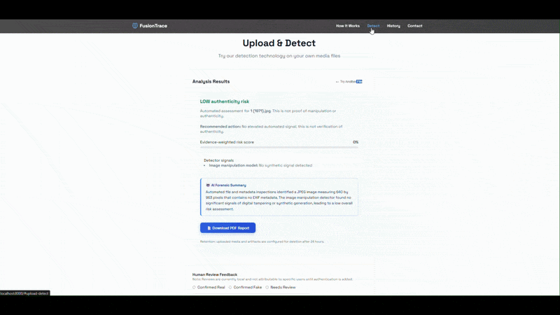

<div align="center">

# 🔍 FusionTrace

### Multimodal Media Authenticity Assessment

*Investigate media authenticity with evidence — not just a score.*

[](https://www.python.org/)
[](https://fastapi.tiangolo.com/)
[](https://pytorch.org/)
[](LICENSE)
[]()

[](resources/images/FusionTrace_Demo.gif)
[](resources/docs/1.pdf)

---



</div>

> **What FusionTrace is:** a local tool that runs several independent detectors over an
> image, audio clip or video and fuses their outputs into a weighted **risk signal** with the
> evidence behind it. **What it is not:** proof that media is real or fake. A low score never
> verifies authenticity, and every detector here has documented blind spots (see
> [Known limitations](#️-known-limitations)).

---

## 💡 Design

1. **Evidence fusion, not a single verdict.** Every scan produces a list of signals, each with
   the model that produced it, its risk, its fusion weight and its status (`ok`, `disabled`,
   `error`, `skipped`). The final score is their weighted mean, and the report shows every input.
2. **Local inference.** All detectors run on your hardware. Media files never leave the
   machine. The only optional network call is the AI summary (below), which sends detector
   outputs only, and only when you tick the box for that scan.
3. **Swappable models.** Every detector sits behind one interface
   ([`backend/app/detectors/base.py`](backend/app/detectors/base.py)) and is chosen by
   config. Any signal can be switched off, and its model name appears in the UI, report and PDF.
4. **Explainability.** Image scans get an attention heatmap from the image model. Audio
   scans report per-window scores across the whole clip. Video scans report per-frame scores
   and a separate temporal signal.

---

## 🧭 What runs for each upload

| Upload | Signals (fusion weight) | Default model |
|---|---|---|
| **Image** | Image model (0.9) | `commfor-vit-s384`: Community Forensics ViT-S/16-384 (MIT, 87 MB) |
| | File inspection: SHA-256, MIME, size (0.1, always risk 0) | — |
| | EXIF / metadata (reported, not scored) | — |
| **Audio** | Synthetic-voice model on sliding 4 s windows over the **whole clip** (0.9) | `wav2vec2-legacy`: FusionTrace's Wav2Vec2-base |
| | File inspection (0.1) | — |
| **Video** | Image model on frames sampled every 5 s, up to 12 (0.8) | `commfor-vit-s384` |
| | Audio model on the extracted soundtrack (0.9) | `wav2vec2-legacy` |
| | Temporal consistency across frames (**0: reported, not scored**) | `frame-consistency-heuristic`: an **uncalibrated heuristic** that does not yet beat chance |
| | File inspection (0.1) | — |

Other registered options, selectable by config:

- **Image:** `gend-clip-l14` (CLIP ViT-L/14, UnivFD-style), `siglip-deepfake-v1`, and `efficientnetv2-legacy` (the v1 model).
- **Audio:** `wav2vec2-xlsr-garystafford`, `wav2vec2-base-melodymachine`.

How they compare: [docs/model-choice.md](docs/model-choice.md).

**Fusion.** `risk_score = Σ(risk × weight) / Σ(weight)` over the signals that ran, rated
`high` at ≥ 70, `medium` at ≥ 40, `low` otherwise. The file-inspection signal always
contributes risk 0 at weight 0.1, so scores top out at about 90. If no detector produces a
signal, the scan fails rather than reporting "low".

**The temporal video signal is switched off for scoring (weight 0).** No permissively licensed,
CPU-friendly learned temporal video model passed selection (the best one inherits a
non-commercial licence). The fallback measures flicker and score jitter across consecutive
frames. On a 10 real + 10 fake public sample it did **not** separate the classes (AUC 0.50), so
it is still computed and shown in the report, but it does not change the score. Set
`detectors.video.weight` above 0 only after it beats chance on a labelled set.

---

## 📊 Quick-check results (not benchmarks)

Small checks run once during the v2 upgrade, on CPU, threshold 0.5. They show the models
behave plausibly; they are not accuracy claims.

**Image** — public sample, 90 real (FairFace) + 90 fake (Stable Diffusion faces, from
`LucaCorvitto/DeepFake-Faces-Stimuli`, made with `realistic-vision-v51`):

| Model | Fake recall | Real recall | AUC |
|---|---|---|---|
| `commfor-vit-s384` (default) | 0.989 | 0.989 | 1.000 |
| `gend-clip-l14` | 0.133 | 0.956 | 0.700 |
| `siglip-deepfake-v1` | 0.100 | 0.467 | 0.155 |
| `efficientnetv2-legacy` (v1) | 0.011 | 1.000 | 0.821 |

**Caveat: this sample overlaps the default model's training data.** `realistic-vision-v51` is
listed in Community Forensics' own generator metadata, so the 1.000 measures recognition of a
generator the model was trained on, not generalization. The real faces (FairFace) were not in
its training data.

**Unseen fakes: face swaps.** The default model was checked on 90 face-swap images
(`bitmind/face-swap`, Apache-2.0, test split) against the same 90 FairFace real faces:

| Model | Fake recall | Real recall | AUC |
|---|---|---|---|
| `commfor-vit-s384` (default) | 0.011 | 0.989 | **0.459** |

On face swaps the default model is at chance. Community Forensics covers image generators,
not face-swap tools, so this is the fair test of unseen fakes. **The image default does not
detect face swaps.** Its diffusion-face results should not be read as general accuracy.

**Why the v1 model looks bad at 0.5 (a threshold problem, not no signal).** Its AUC is 0.821,
but it catches 1.1% of fakes at the 0.5 threshold, because its fake scores all sit near 0.
Lowering the threshold to about 0.001 recovers 42% of fakes at 92% real recall, so the ranking
carries signal. That threshold was read off this same 90 + 90 sample, so it is fitted to it,
and the v2 default keeps the standard 0.5 threshold.

**Audio**: In-the-Wild sample, 50 real + 50 fake:

| Model | Real recall | Fake recall | AUC |
|---|---|---|---|
| `wav2vec2-legacy` (default) | 1.00 | 0.74 | 0.916 |
| `wav2vec2-xlsr-garystafford` | 0.90 | 0.44 | 0.682 |
| `wav2vec2-base-melodymachine` | 0.44 | 0.18 | 0.296 |

**Video temporal signal**: 10 real + 10 fake public clips: AUC 0.50 (does not separate the
classes yet; weight 0, so it does not affect the score).

**Label mapping check.** The `siglip-deepfake-v1` and `wav2vec2-base-melodymachine` fake-class
indices match their configs (`siglip`: 0 = Fake; `melodymachine`: 0 = fake) and their preprocessing
matches the model configs. On their own checks the low AUCs are not a label swap: a flip would
improve one dataset and worsen the other (`siglip` AUC is 0.788 on the local set with the current
mapping), so the mapping was left unchanged. Both models fail to transfer to these datasets.

Full tables, datasets and revisions:
[docs/model-choice.md](docs/model-choice.md).

---

## 💻 Getting started

You need Python 3.11+, FFmpeg (with `ffprobe`) on `PATH`, and about 4 GB of free RAM for the
default models.

### Local

```bash
git clone https://github.com/MuthuVarshith/FusionTrace.git
cd FusionTrace
python -m venv .venv && source .venv/bin/activate      # Windows: .venv\Scripts\activate
pip install -r requirements.txt                          # pinned, CPU-only torch
cp backend/.env.example backend/.env                     # optional settings

cd backend
python scripts/download_models.py                        # fetches weights for the enabled detectors
python -m uvicorn app.main:app --host 127.0.0.1 --port 8000
```

Open <http://localhost:8000>. `GET /health` lists each detector: enabled, model, weight, and
whether its weights are available and loaded.

> **Legacy weights.** The default audio model (`wav2vec2-legacy`) and the optional
> `efficientnetv2-legacy` image model are FusionTrace's own weights. They are not on a public
> Hub repo. `download_models.py` fetches them only when `HF_REPO_ID` names your mirror
> (`HF_TOKEN` if it is private); otherwise put them under `backend/models/audio_model/` and
> `backend/models/image_model/`. Without them, audio scans report the audio model as
> unavailable.

Run **one app process**. The scan queue and rate limiter live in memory, so extra
uvicorn workers would each load every model and keep separate queues.

### Docker Compose

```bash
cp backend/.env.example backend/.env
docker compose up --build            # http://localhost:8000; PORT=9000 docker compose up to change it
```

The container fetches missing weights into the `models` volume at start-up (idempotent), then
serves on `$PORT`. Weights are never baked into the image, so `HF_TOKEN` stays out of it.

### Hugging Face Spaces (free CPU tier)

Step-by-step guide: [docs/deploy-hf-spaces.md](docs/deploy-hf-spaces.md). It covers the Space
card, `PORT=7860`, secrets, start-up downloads, and `FUSIONTRACE_VIDEO_ENABLED=false` when
memory is tight.

---

## ⚙️ Configuration

Detectors are configured in [`backend/config.yaml`](backend/config.yaml). Each one can be
overridden from the environment:

| Variable | Effect |
|---|---|
| `FUSIONTRACE_IMAGE_MODEL` / `_AUDIO_MODEL` / `_VIDEO_MODEL` | Registry key of the detector to use (e.g. `efficientnetv2-legacy`) |
| `FUSIONTRACE_<KIND>_ENABLED` | `false` switches that signal off |
| `FUSIONTRACE_<KIND>_WEIGHT` | Fusion weight |
| `FUSIONTRACE_MODEL_DIR` | Where weights live (default `backend/models`) |
| `FUSIONTRACE_DEVICE` | `auto`, `cpu` or `cuda` |
| `FUSIONTRACE_API_KEYS` | Comma-separated keys. Unset means no auth (local use). When set, `/api/*` requires `X-API-Key` and every scan is visible only to the key that created it |
| `FUSIONTRACE_UPLOAD_RATE_LIMIT`, `FUSIONTRACE_FEEDBACK_RATE_LIMIT` | Requests per window, per key (or per IP when auth is off); 429 when exceeded |
| `FUSIONTRACE_MAX_CONCURRENT_SCANS` | Worker pool size (default 1) |
| `FUSIONTRACE_MAX_UPLOAD_MB`, `_MAX_AUDIO_SECONDS`, `_MAX_VIDEO_SECONDS`, `_MAX_IMAGE_PIXELS` | Upload limits, checked with `ffprobe` / PIL before a scan is queued |
| `FUSIONTRACE_RETENTION_HOURS` | Uploads and heatmaps older than this are deleted (scans in progress are skipped) |
| `GEMINI_API_KEY`, `GEMINI_MODEL` | Enable the optional AI summary |

[`backend/.env.example`](backend/.env.example) lists every variable the app reads, with defaults.

---

## 🤖 Optional AI summary

When `GEMINI_API_KEY` is set, the upload form offers an **off-by-default** checkbox. If you
tick it, a 2–3 sentence hedged summary is generated from the detector outputs after the
verdict is shown. Only detector labels, risks and model names are sent: never the media file,
its hash, or its EXIF. Without a key the checkbox is disabled and everything else works.

---

## 🔌 REST API

Interactive docs: `http://localhost:8000/docs`.

| Method | Endpoint | Description |
|---|---|---|
| `GET` | `/health` | Detector status (model, enabled, weight, available, loaded) and whether summaries are available |
| `POST` | `/api/scans` | Multipart: `file`, optional `generate_ai_summary=true`. Returns `202` with the scan id; the scan waits in the queue |
| `GET` | `/api/scans/{id}` | Status `queued` → `processing` → `completed` / `failed`, plus the report |
| `GET` | `/api/scans` | Recent scans (scoped to the caller's key when auth is on) |
| `POST` | `/api/scans/{id}/feedback` | `{"label": "confirmed_real" \| "confirmed_fake" \| "needs_review", "notes": "..."}` |
| `GET` | `/api/scans/{id}/heatmap` | Image explanation overlay once `report.heatmap_ready` is true |

Clients get generic error messages only. Full error details go to the server log.

---

## 🧪 Evaluation and MLOps

- `backend/scripts/evaluate_models.py`: AUC, precision, recall, F1 and a confusion matrix per
  detector on labelled `real/` and `fake/` folders (image, audio or video).
- `backend/scripts/export_onnx.py`, `quantize_onnx.py`, `benchmark_models.py`: ONNX export
  with a parity check, INT8 quantization, and CPU latency/memory/size comparisons.
- Optional MLflow tracking and a local model registry.

Commands: [docs/mlops.md](docs/mlops.md). Model-specific quick checks:
`backend/scripts/check_{image,audio,video}_models.py`.

```bash
uv sync --extra dev                  # or: pip install -r requirements.txt ruff pytest httpx
FUSIONTRACE_WARMUP=0 pytest          # backend/tests; tests needing downloaded weights skip without them
ruff check .
```

CI ([`.github/workflows/ci.yml`](.github/workflows/ci.yml)) checks the lock file, runs ruff
and pytest, and builds the Docker image.

---

## 🔒 Privacy and security

- Inference is local; media is never uploaded anywhere.
- Uploads are validated by content (PIL `verify` plus a pixel cap for images; `ffprobe`
  stream and duration checks for audio/video), not by file extension.
- Optional API keys, with per-key scoping of scans and stored owner hashes (never the keys).
- Rate limits on uploads and feedback; a bounded scan queue.
- Per-scan working files are deleted when a scan finishes; uploads and heatmaps follow the
  retention window.
- The model download path prefers safetensors and never uses `trust_remote_code`.

---

## ⚠️ Known limitations

| Limitation | Detail |
|---|---|
| **Results are risk signals, not proof** | No detector here is calibrated for your data. Treat high scores as "review this", and low scores as "nothing flagged", not "authentic". |
| **Image default fails on face swaps** | AUC 0.459 (chance) on 90 face-swap images. Its strong diffusion-face result is on a generator it was trained on. It has no face-swap detection; use it with that in mind. |
| **Temporal video signal is a heuristic, weight 0** | Uncalibrated, AUC 0.50 on its 10 + 10 check. Computed and shown, but it does not affect the score. No lip-sync model. |
| **Audio default is the v1 model** | It held up on In-the-Wild (AUC 0.916, n = 100). Its weights are private (see Getting started). |
| **Single process** | The queue and rate limits are in memory, and SQLite is the only store, so this does not scale horizontally. |
| **CPU speed** | Roughly 1.4 s per 4 s audio window; long videos are capped by a processing budget. |

---

## 📁 Project structure

```
FusionTrace/
├── backend/
│   ├── app/
│   │   ├── main.py              # FastAPI routes, auth, rate limits
│   │   ├── service.py           # Scan lifecycle, fusion, persistence, enrichments
│   │   ├── pipeline.py          # Media kind → evidence signals via the registry
│   │   ├── jobs.py              # Bounded in-process scan queue
│   │   ├── validation.py        # ffprobe / PIL upload checks
│   │   ├── detectors/
│   │   │   ├── base.py          # The shared Detector interface
│   │   │   ├── registry.py      # Config-driven selection
│   │   │   ├── image/           # commfor, GenD CLIP, SigLIP, legacy EfficientNetV2
│   │   │   ├── audio/           # Windowed Wav2Vec2 detectors
│   │   │   └── video/           # Frame-consistency heuristic
│   │   └── ai_summary.py        # Optional Gemini summary
│   ├── mlops/                   # MLflow tracking + registry helpers
│   ├── scripts/                 # download, evaluate, export/quantize/benchmark, quick checks
│   ├── templates/               # UI (vanilla JS) and static assets
│   └── tests/
├── deploy/                      # Docker entrypoint, HF Spaces kit
├── docs/                        # Model choice, upgrade notes, deploy, MLOps, LFS cleanup
├── pyproject.toml / uv.lock     # Single pinned manifest
├── requirements.txt             # Generated from uv.lock
├── Dockerfile / docker-compose.yml
└── .github/workflows/ci.yml
```

What changed in v2 and why: [docs/upgrade-notes.md](docs/upgrade-notes.md).

---

<div align="center">
  <sub>FusionTrace — evidence-based media authenticity signals. Built by Muthu Varshith.</sub>
  <br>
  <sub>Released under the <a href="LICENSE">MIT License</a>. Third-party model weights keep their own licences (see docs/model-choice.md).</sub>
</div>
